# Jadwal Sholat KHGT Muhammadiyah

Plugin WordPress open source untuk menampilkan **jadwal sholat harian** beserta **tanggal Hijriah (KHGT)** di situs Anda, lewat widget sidebar atau shortcode. Pengunjung bisa mencari kota mana pun atau memakai deteksi lokasi (GPS) perangkatnya.

Dibuat oleh **mastrigus (MPID PDM Trenggalek)** dan dirilis dengan lisensi **GPL-2.0-or-later**.

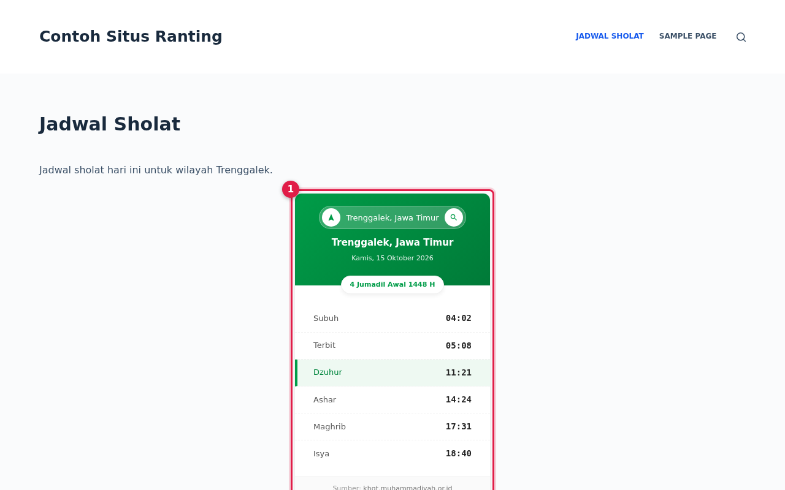

## Fitur

- Widget klasik **Jadwal Sholat KHGT** (Tampilan > Widget) dengan isian *Kota Default*.
- Shortcode `[jadwal_sholat_khgt kota="Trenggalek"]` untuk laman, pos, atau blok *Shortcode*.
- Waktu Subuh, Terbit, Dzuhur, Ashar, Maghrib, dan Isya; waktu sholat berikutnya diberi sorotan.
- Tanggal Hijriah ditampilkan sebagai lencana (contoh: *4 Jumadil Awal 1448 H*).
- Cari kota (kolom pencarian) atau tombol panah untuk memakai lokasi perangkat.
- Beberapa widget/shortcode bisa dipakai pada satu halaman.
- Ringan: CSS dan JS hanya dimuat pada halaman yang memakai widget atau shortcode. Tanpa jQuery.

## Kebutuhan

- WordPress 5.0 atau lebih baru, PHP 7.4 atau lebih baru.
- Pengunjung situs perlu koneksi internet (data diambil dari browser pengunjung, lihat bagian [Cara kerja](#cara-kerja)).

## Pemasangan

### Cara 1: unggah berkas ZIP (disarankan)

1. Unduh `khgt-jadwal-sholat.zip` dari halaman **Releases** repositori ini. Jangan memakai tombol *Code > Download ZIP*, karena berkas itu berisi folder bernama `khgt-jadwal-sholat-main` dan ikut membawa dokumentasi.
2. Masuk ke dasbor WordPress, lalu buka **Plugin > Tambahkan Plugin**.

   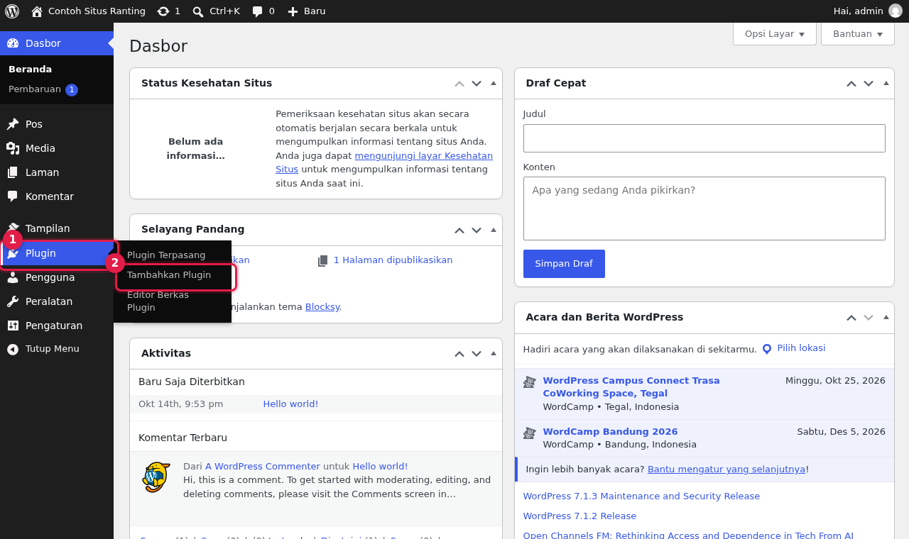

3. Klik **Unggah Plugin** di bagian atas halaman.

   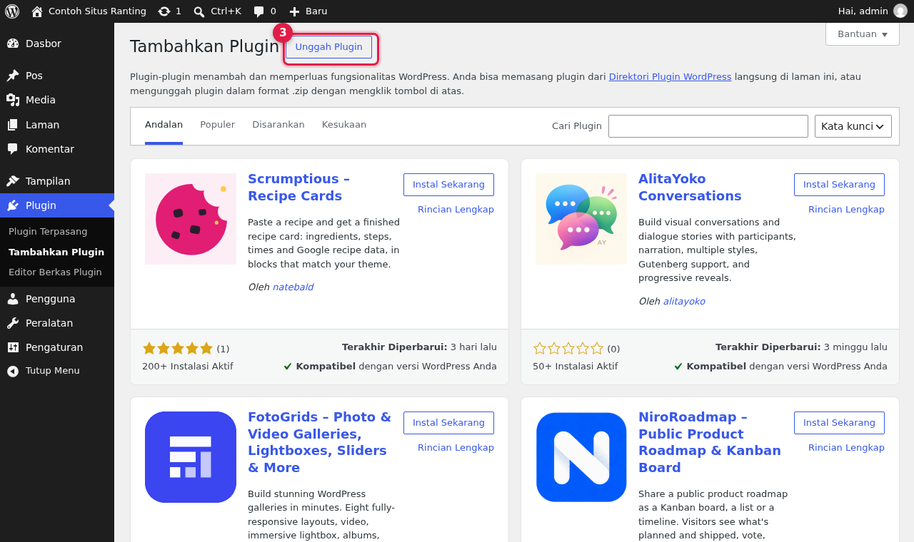

4. Pilih berkas ZIP tadi, lalu klik **Instal Sekarang**.

   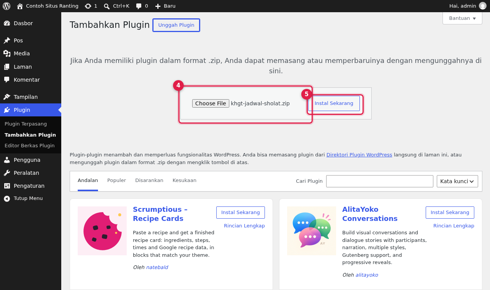

5. Setelah muncul tulisan *Plugin berhasil dipasang*, klik **Aktifkan Plugin**.

   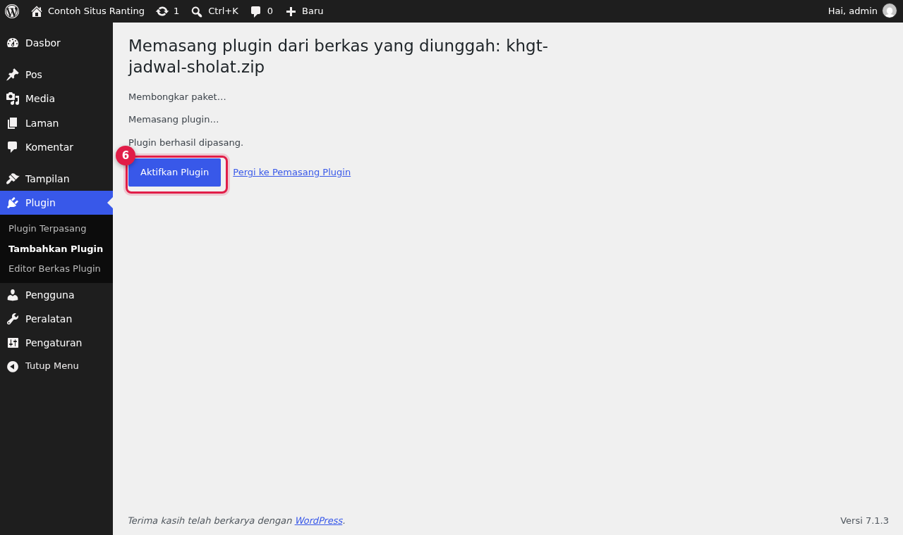

6. Plugin muncul di daftar **Plugin Terpasang** dengan status aktif.

   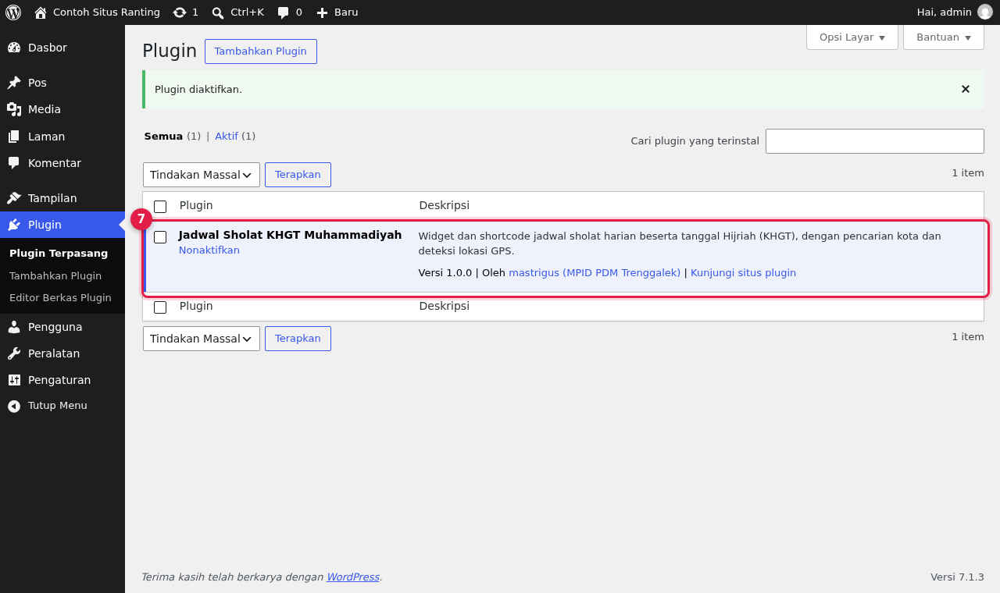

### Cara 2: lewat FTP / File Manager

Ekstrak ZIP, lalu unggah folder `khgt-jadwal-sholat` ke `wp-content/plugins/`. Aktifkan dari **Plugin > Plugin Terpasang**.

## Cara memakai

### A. Sebagai widget (sidebar / footer)

1. Buka **Tampilan > Widget**.

   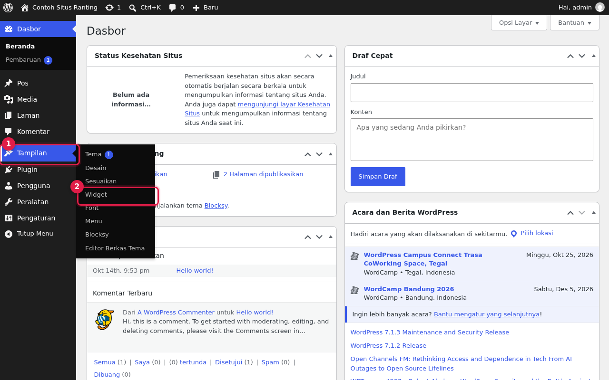

2. Klik tombol **+**, ketik *Jadwal Sholat*, lalu pilih **Jadwal Sholat KHGT**.

   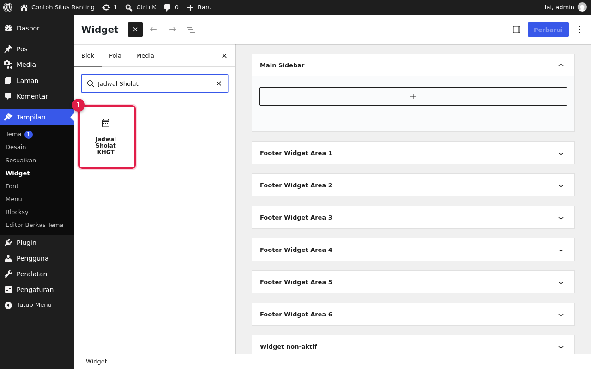

3. Isi **Kota Default** (kota yang tampil saat lokasi pengunjung tidak diketahui), lalu klik **Perbarui**.

   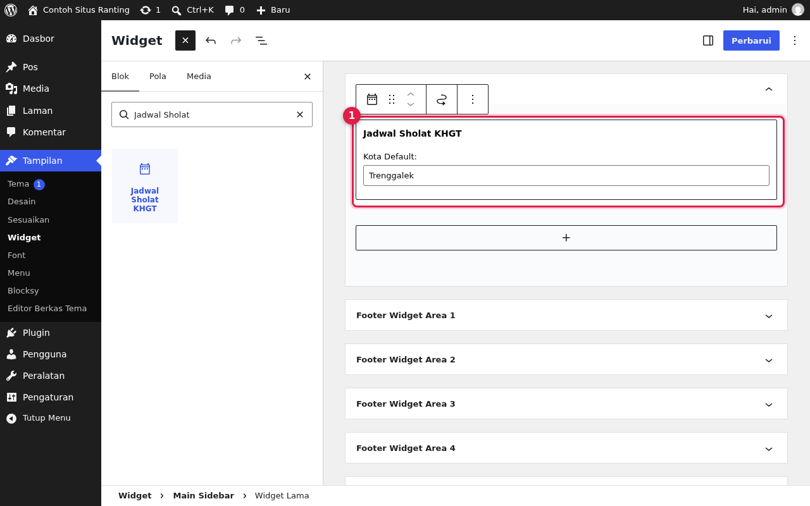

   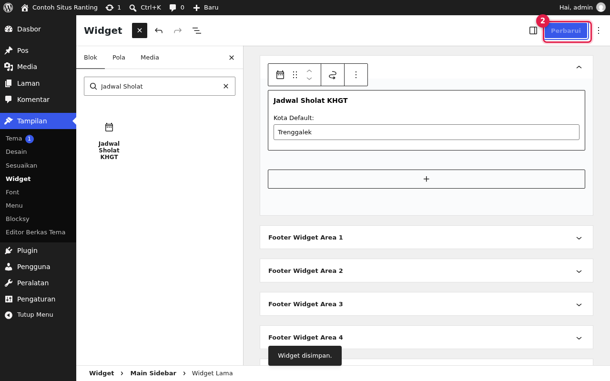

4. Buka situs Anda. Widget tampil di area widget yang dipilih.

   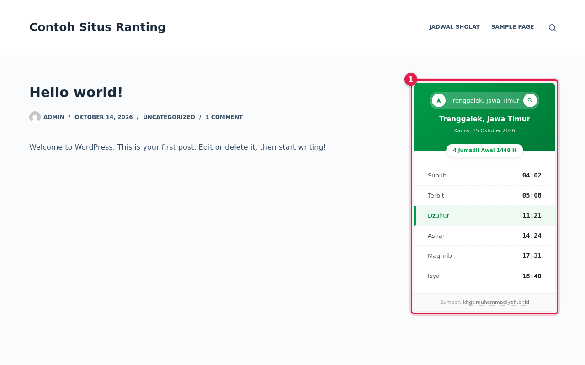

> **Catatan tema.** Widget hanya tampil jika tema menampilkan area widget tersebut. Pada tema Blocksy misalnya, sidebar perlu diaktifkan terlebih dahulu di **Tampilan > Sesuaikan** (pengaturan struktur Pos/Laman). Jika sidebar tidak aktif, pakai shortcode.

### B. Sebagai shortcode

Tempel shortcode berikut pada blok **Shortcode** (atau langsung di editor klasik):

```
[jadwal_sholat_khgt kota="Trenggalek"]
```

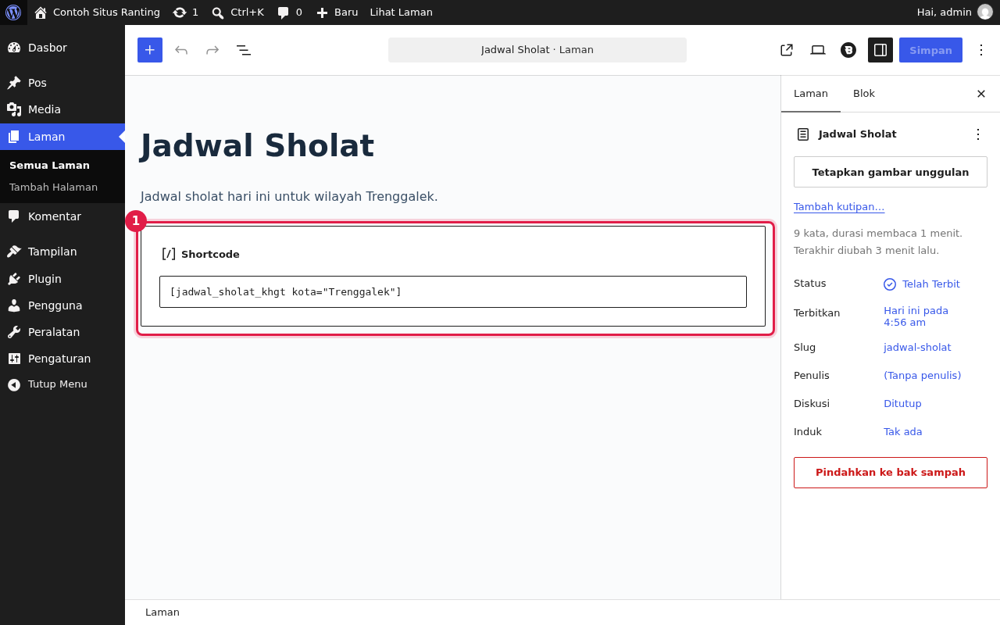

Atribut `kota` bersifat opsional; bila dikosongkan, nilai bawaannya **Yogyakarta**.

### Mencari kota

Pengunjung dapat mengetik nama kota pada kolom pencarian lalu menekan Enter atau tombol kaca pembesar.

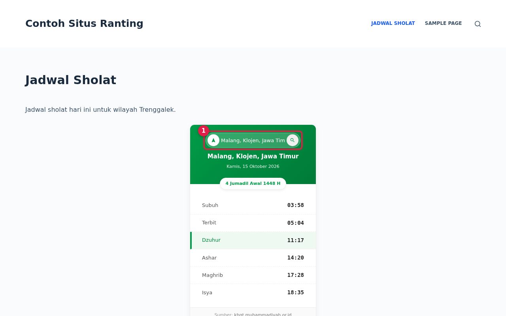

## Cara kerja

```
Browser pengunjung
  1. POST {API}/search    { q: "Trenggalek" }                  -> nama, lat, lng
  2. POST {API}/schedule  { lat, lng, date, mode: "daily" }    -> waktu sholat + tanggal Hijriah
```

- **Sisi server (PHP)** hanya merender kerangka HTML widget dan memuat aset: kelas `KHGT_Prayer_Widget` (turunan `WP_Widget`), fungsi `khgt_render_widget_html()`, dan shortcode `jadwal_sholat_khgt`. Alamat API diteruskan ke JavaScript lewat `wp_localize_script()` (objek `khgtConfig`).
- **Sisi browser (`assets/js/khgt-widget.js`)** memanggil API, menyusun daftar waktu, dan menyorot waktu sholat berikutnya. Hasil pencarian kota disimpan di `sessionStorage` agar tidak diminta ulang.
- Saat halaman dibuka, widget langsung meminta izin lokasi dari browser. Jika ditolak atau tidak tersedia, widget memakai *Kota Default*.
- Untuk nama tempat dari GPS, widget memanggil layanan geokode balik **Nominatim (OpenStreetMap)**.
- Semua gaya memakai awalan `nm-ws-` agar tidak bentrok dengan tema.

### Ketergantungan pada API pihak ketiga

Data jadwal diambil dari layanan web (Cloudflare Worker) di `https://khgt-api-dev.matadigital.workers.dev/api/sholat`. Perhatikan hal berikut:

- Plugin ini **bukan produk resmi** Muhammadiyah maupun tim KHGT, dan layanan di atas **tidak dikelola** oleh pengembang plugin.
- Nama host memuat kata `dev`, sehingga ketersediaan dan stabilitasnya tidak dijamin. Bila layanan berubah atau berhenti, widget akan menampilkan *"Gagal memuat jadwal"*.
- Tulisan *Sumber: khgt.muhammadiyah.or.id* di kaki widget merujuk ke situs KHGT sebagai acuan metode dan kalender, bukan alamat API yang dipanggil.
- Alamat API dapat diganti dengan mengubah nilai `apiBase` di `khgt-jadwal-sholat.php`, selama layanan pengganti memakai format permintaan dan respons yang sama.

## Keterbatasan yang diketahui

- Sorotan "waktu sholat berikutnya" memakai jam perangkat pengunjung; setelah Isya tidak ada baris yang disorot.
- Imsak dan Dhuha tersedia di API tetapi belum ditampilkan.
- Tanggal yang diminta mengikuti zona Asia/Jakarta, sedangkan sorotan mengikuti jam perangkat.
- Memerlukan JavaScript aktif di browser pengunjung.
- Belum ada terjemahan (hanya Bahasa Indonesia) dan belum ada halaman pengaturan.

## Struktur berkas

```
khgt-jadwal-sholat/
├── khgt-jadwal-sholat.php   # header plugin, widget, shortcode, enqueue aset
├── readme.txt               # format readme WordPress.org
├── assets/
│   ├── js/khgt-widget.js    # logika pemanggilan API dan render
│   └── css/khgt-widget.css  # tampilan (awalan nm-ws-)
└── LICENSE
```

## Membuat berkas ZIP rilis

```bash
git archive --prefix=khgt-jadwal-sholat/ -o khgt-jadwal-sholat.zip HEAD
```

`.gitattributes` mengecualikan `docs/`, `README.md`, dan berkas pendukung git dari ZIP, sehingga hasilnya hanya berisi plugin.

## Berkontribusi

Isu dan pull request dipersilakan di <https://github.com/trenggalekmu/khgt-jadwal-sholat>.

## Lisensi dan kredit

Plugin ini dirilis di bawah **GNU General Public License v2.0 atau yang lebih baru** (lihat berkas [LICENSE](LICENSE)).

Hak cipta (c) 2026 **mastrigus (MPID PDM Trenggalek)**.
